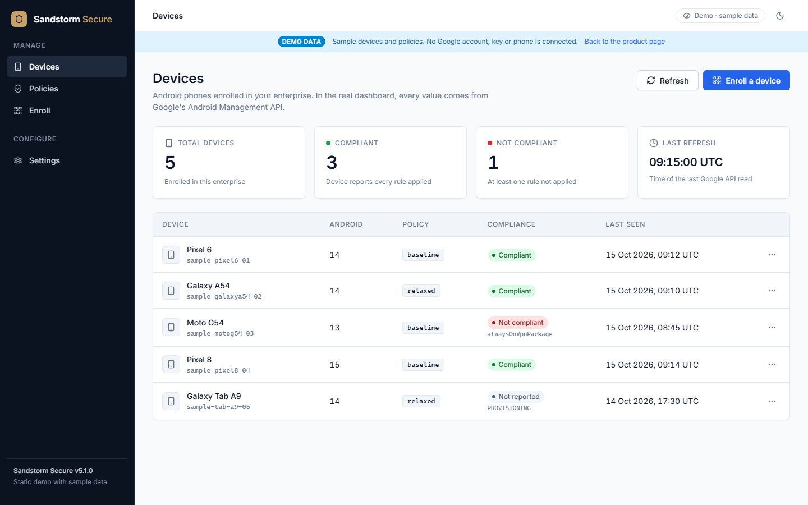
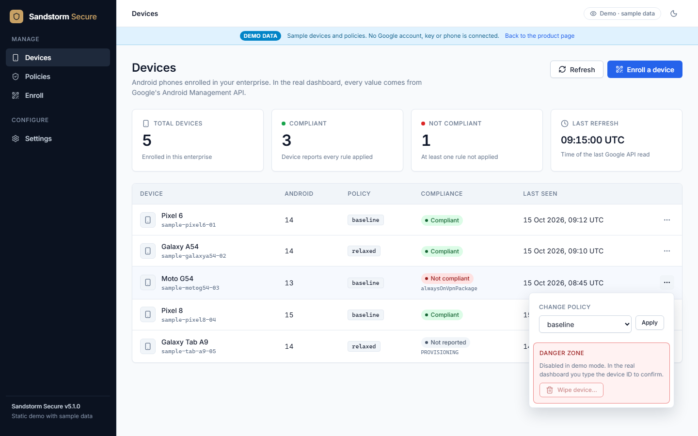
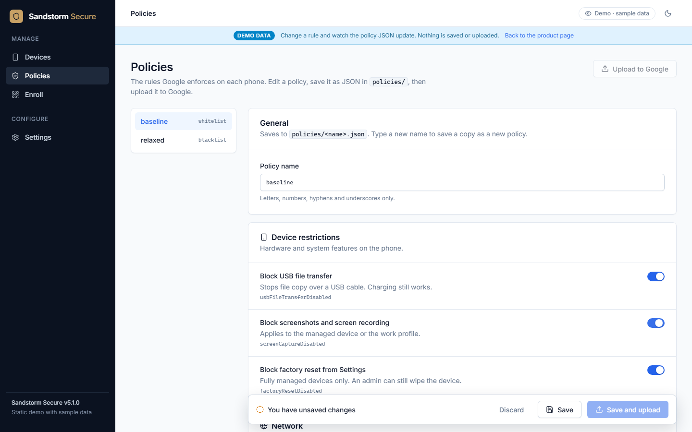
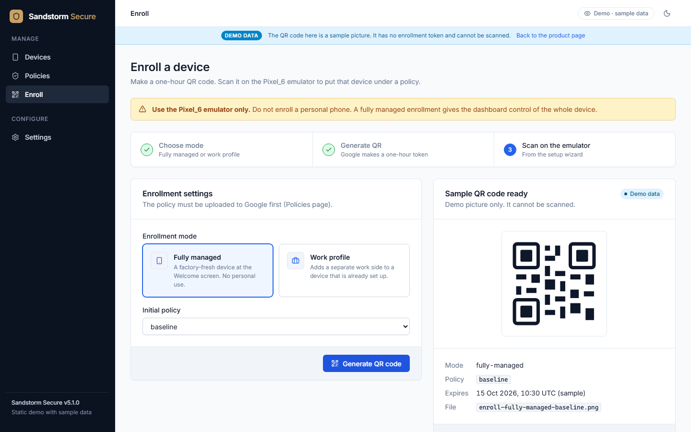
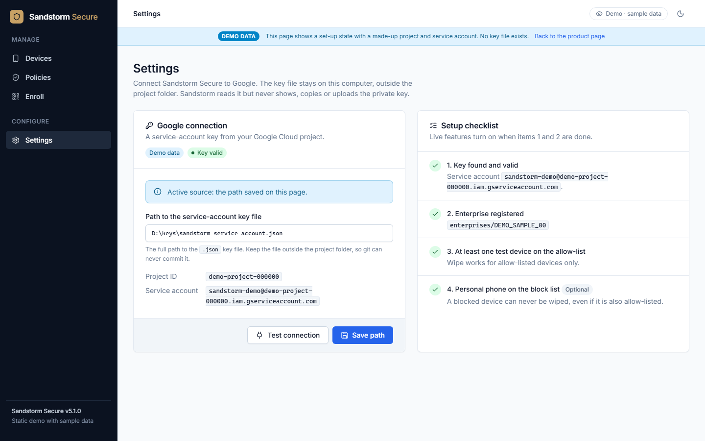
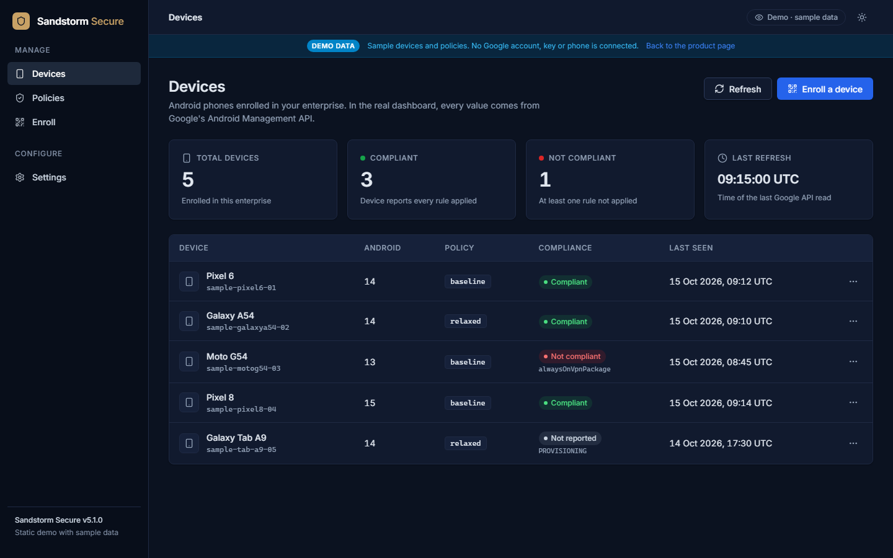
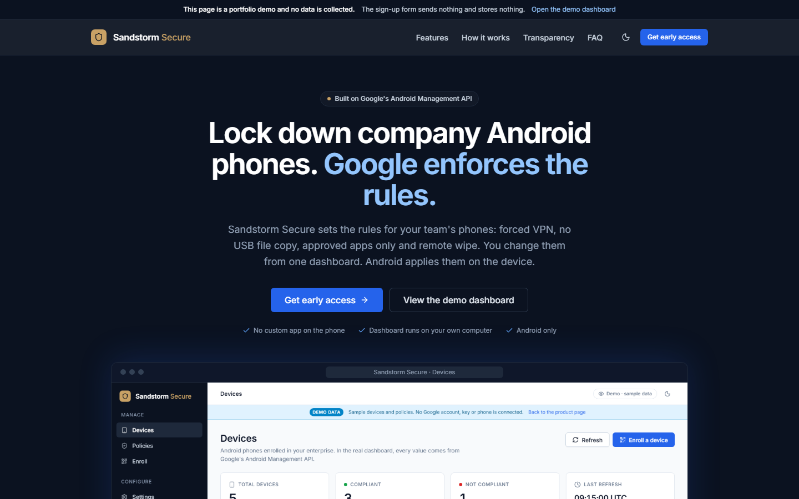

# Sandstorm Secure

A local Android phone-management (MDM) CLI and dashboard built on Google's
[Android Management API](https://developers.google.com/android/management).
It applies a locked-down policy to an Android device and lets you change that policy
from a command-line interface or a local web dashboard.

**Live site:** [Product page](https://sandeeepkiran.github.io/Sandstorm-Secure/landing/) · [Demo with sample data](https://sandeeepkiran.github.io/Sandstorm-Secure/demo/). The real dashboard runs only on your own computer (`127.0.0.1`), because it can wipe phones.

[](docs/media/sandstorm-secure-launch.mp4)

*The 21-second launch video, made from the v5.1.0 demo pages with sample data. [Watch it in full quality, with sound (MP4)](docs/media/sandstorm-secure-launch.mp4).*

**Status:** `v5.1.0`. Milestones M1 (Core + CLI), M2 (local web dashboard), M5 (mock landing page) and M6 (sample-data demo) are complete and tested offline. v5.1.0 adds a professional redesign, a dark theme and a Settings page for the Google key. Next: the live end-to-end proof on the Android emulator (M3) and work-profile mode (M4).

## Screenshots

All screenshots show the static demo with sample data. The real dashboard uses the same design.



| Device actions and Danger zone | Policies with toggle switches |
|---|---|
|  |  |
| **Enroll with a 3-step stepper** | **Settings and setup checklist** |
|  |  |
| **Dark theme** | **Landing page** |
|  |  |

## What it does

- Creates and uploads device policies (`policies/baseline.json` and `policies/relaxed.json`) for VPN lockdown, USB data block, app allow-list, screen capture block, factory reset block, and screen-lock strength.
- Generates enrollment tokens and saves setup-wizard QR codes (`output/*.png`) for `fully-managed` and `work-profile` modes.
- Lists enrolled devices with real API values (ID, model, Android version, active policy, last-seen timestamp, and compliance state).
- Switches an enrolled device between policies, or wipes an allow-listed test device after typed confirmation.

## What it can see

An MDM provider can see device hardware details (model, Android version), the applied policy state, compliance reports, and the list of installed apps.
This project displays only what the Google Android Management API returns — no hard-coded statuses or fake metrics.

## How to run the offline tests (STE)

1. Open a PowerShell terminal in the project folder.
2. Run the offline test suite:
   ```powershell
   python -m pytest -q
   ```
3. Verify the CLI version:
   ```powershell
   python -m sandstorm --version
   ```

## How to connect the dashboard to Google (STE)

> **WARNING:** Keep the service-account key file outside this project folder. A key inside the folder can go into git by mistake. The dashboard refuses a path inside the project folder.

1. Save the service-account key file (`.json`) in a folder outside this project.
2. Start the dashboard:
   ```powershell
   python -m sandstorm web
   ```
3. Open `http://127.0.0.1:8000/settings` in the browser.
4. In **Path to the service-account key file**, type the full path to the key file.
5. Select **Save path**.
6. If the page shows an error under the field, correct the path and select **Save path** again.
7. Select **Test connection**.
8. Make sure that the result is green.
9. If the setup checklist shows "2. Enterprise registered" with a red mark, run `python -m sandstorm create-enterprise` in a terminal. Then reload the page.

The env var `SANDSTORM_SA_KEY` overrides the saved path. The Settings page shows the active source.

## CLI commands (STE)

> **WARNING:** Never enroll, lock, or wipe a personal phone. Only use the `Pixel_6` Android emulator.

1. Before you run a live command, give the key path. Use the Settings page (see above), or set the `SANDSTORM_SA_KEY` environment variable to the path of the key file (stored outside this repository):
   ```powershell
   $env:SANDSTORM_SA_KEY = "path\to\your-service-account-key.json"
   ```
2. To register your enterprise and save its name to `sandstorm.local.json`, run:
   ```powershell
   python -m sandstorm create-enterprise
   ```
3. To upload the baseline and relaxed policies, run:
   ```powershell
   python -m sandstorm apply-policy policies\baseline.json
   python -m sandstorm apply-policy policies\relaxed.json
   ```
4. To list all uploaded policies in your enterprise, run:
   ```powershell
   python -m sandstorm list-policies
   ```
5. To create a `fully-managed` enrollment QR code PNG in `output\`, run:
   ```powershell
   python -m sandstorm enroll-qr --mode fully-managed --policy baseline
   ```
6. To list all enrolled devices and their compliance state, run:
   ```powershell
   python -m sandstorm list-devices
   ```
7. To move a device to another policy, run:
   ```powershell
   python -m sandstorm switch-policy <DEVICE_ID> relaxed
   ```
8. To wipe a test device (the device ID must exist in `allowed_test_devices` inside `sandstorm.local.json`), run:
   ```powershell
   python -m sandstorm wipe <DEVICE_ID>
   ```
9. To start the local web dashboard on `http://127.0.0.1:8000`, run:
   ```powershell
   python -m sandstorm web
   ```

## How to change the design (STE)

1. Edit `sandstorm/web/static/style.css` or `sandstorm/web/static/ui.js`. These are the master copies.
2. Copy the changes to the demo and the landing page:
   ```powershell
   python scripts\sync_shared_assets.py
   ```
3. Make the screenshots again:
   ```powershell
   python scripts\capture_screenshots.py
   ```
4. Run the tests. A test fails if the copies in `demo/` and `landing/` are different from the master copies.

Credits: [Inter](https://rsms.me/inter/) font (SIL Open Font License 1.1) and [Lucide](https://lucide.dev) icons (ISC licence), stored in `sandstorm/web/static/vendor/`.

## License

[GNU Affero General Public License v3.0 or later](LICENSE) (AGPL-3.0-or-later). You may use, change and share it. If you share a changed version, or run it for others over a network, you must share its source code under the same licence.
